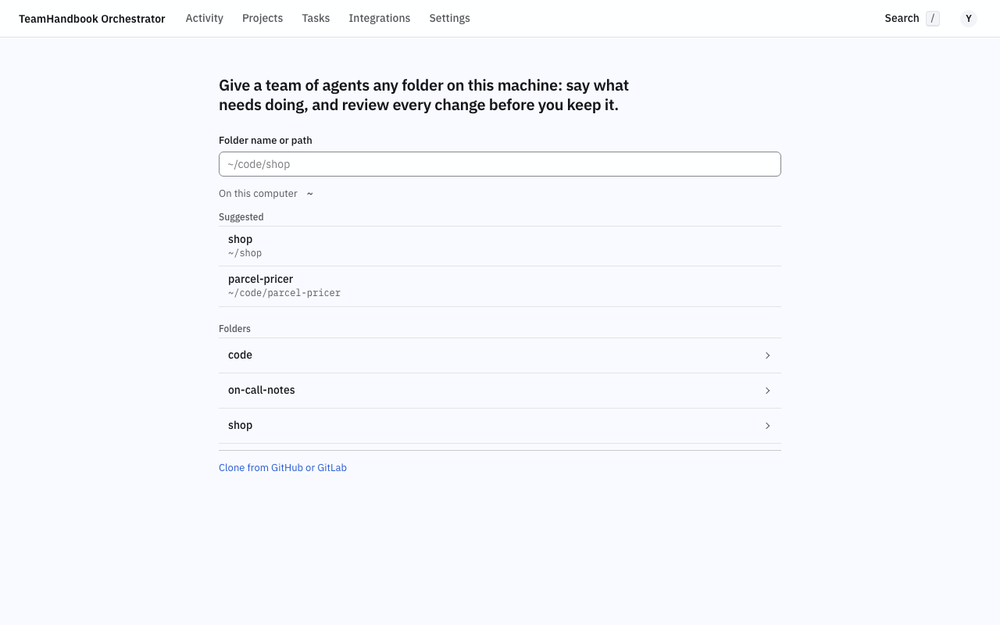

# TeamHandbook Orchestrator

Your team's skills, MCP servers and commands in one place, and the Claude Code signed in on your
own machine doing a piece of work in any folder you open, with every change waiting for your review.

```sh
npx teamhandbook-orchestrator@latest
curl -fsSL https://github.com/AhmetErenLapanta/TeamHandbook/releases/download/handbook-orchestrator-latest/install.sh | sh && handbook-orchestrator
git clone https://github.com/AhmetErenLapanta/TeamHandbook.git && cd TeamHandbook && npm start
```

Each starts the orchestrator on this machine and opens it in your browser: no env file, no
Docker, no account. `handbook-orchestrator service install` keeps it running whenever you are
logged in, `handbook-orchestrator update` moves to the newest release, `handbook-orchestrator
doctor` says what is wrong and how to set it right, and `handbook-orchestrator --help` lists the
rest. To work on the orchestrator itself, `npm run dev` from a clone starts the server and the
screens with live reload; its settings go in `ORCHESTRATOR_*`, for instance
`ORCHESTRATOR_PORT=8090 npm run dev`.

## Run it on your machine

You need Node 22.16 or later, git, and Claude Code or OpenCode signed in on this machine, once,
the way you always do (`claude`, or `opencode auth login`).

The command prints the address it listens on and opens it; a sign-in link in the data folder
opens it once if the browser does not. The first screen asks one thing, which folder:

1. **Open a folder**: a **Suggested** folder opens with a click, and when any listed folder has
   Git, each row says **Git** or **No Git**. In the list, a click goes into a folder, **Up one folder** goes back, and **Open <name>** at the foot opens the one you picked;
   **Folder name or path** finds another. **Clone from GitHub or GitLab** clones one with your own
   git sign-in into `~/code/<name>` instead. A folder is taken only inside your home folder, never a
   hidden one or one under `~/Library`.
2. **What should the agent do here?**: describe the change and press **Start**. The agent signed
   in on this machine does it, Claude Code first when both are ready. Under the empty box, **Or start with** offers up to three
   tasks read off the folder (a TODO or FIXME note of its code, quoted from its file, or running
   the tests or the linter its `package.json` names); picking one only fills the box.
3. **Review the change.** In a folder without Git the agent edits the files in place, and the
   task's page shows **Changes**, each file with its diff: **Keep these changes**,
   or **Undo these changes…** to put each file back as it was before the task.
   In a Git repository the agent works in a copy of its own and the task ends in a request, so
   nothing reaches the repository until you merge it; **Make this a Git repository**, on the
   project's **Settings** tab, makes a folder one. Everything waiting for you is under Projects >
   **To review**.



With a stand-in agent, from the first screen to a task waiting for review took 37 seconds in a
folder without Git and 34 in a Git repository, two decisions and two screens; the agent's own
work comes on top.

A task runs as you: Claude Code starts with your own setup, as in your own sessions (your
settings, memory, CLAUDE.md, skills, plugins, hooks and MCP servers), plus the team's skills for
the task. A folder's own project settings load only once you trust them: the task's page asks
once per project, "Use this folder's own Claude Code settings for the next tasks here?", with
**Use them** or **Keep them off**. The
orchestrator's guard still holds: an MCP tool that writes to a tracker is denied first, then
every other MCP tool that does not read (get, list, search and the like), and the agent writes
only inside the folder it works in. `ORCHESTRATOR_TASK_PROFILE=isolated` gives the agent a profile of its
own instead. With OpenCode, each task gets an OpenCode server of its own on this machine, which
stops when the task does; its rules keep it inside the task's folder, deny the shell and the web
and every tool named for a tracker or a forge, and ask you before any other tool. When the agent
asks before it does something, the task's page shows the question
with **Allow once**, **Allow for this task** and **Deny…**, which takes a note for the agent
before you deny.

Its data stays in one folder: `~/Library/Application Support/TeamHandbook Orchestrator` on macOS,
`$XDG_DATA_HOME/teamhandbook-orchestrator` (or `~/.local/share/teamhandbook-orchestrator`) on
Linux, `%APPDATA%\TeamHandbook Orchestrator` on Windows; `--data-dir <folder>` or
`ORCHESTRATOR_DATA_DIR` picks another, and `--port <n>` and `--no-open` set the rest. It
answers this machine only. Ctrl-C stops it. To delete its data, stop it and delete that folder;
`handbook-orchestrator service uninstall` only stops it starting on its own, and leaves the
folder and `~/.handbook-orchestrator/service.env` where they were.

On your machine the orchestrator puts no limit on the network: an agent reaches whatever your
machine reaches, as it does when you run it yourself. The egress proxy that holds a task to its
repository's allow list is for a task in a container on a team's server.

## More

Running it for a team or as a cloud service, connecting GitLab, GitHub and Jira, and how it
works inside: [docs/README.md](docs/README.md). On a team's orchestrator your tasks run on your
own machine once you connect it under Settings > **Your machines**
([The screens](docs/user/screens.md#the-screens)).

## License

Apache-2.0, as the rest of the repository.
